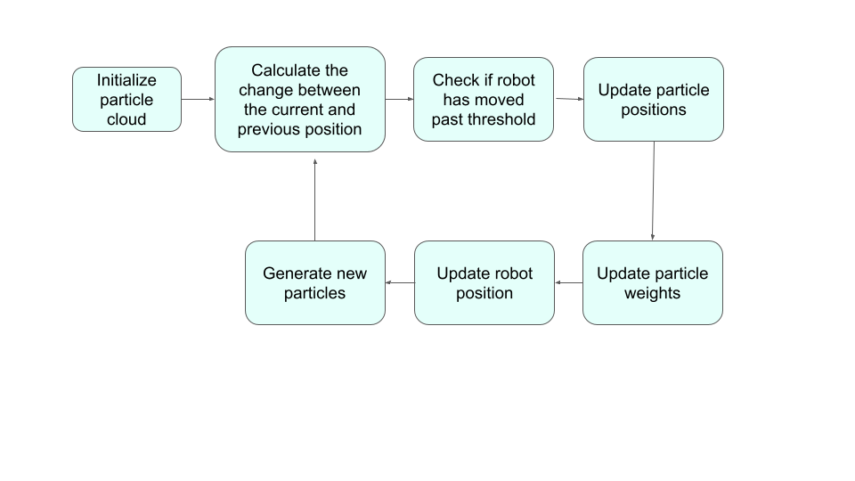

# State Estimation and Localization

**ENGR 3590: Computational Intro to Robotics**

Irene Hong and Vanessa Aguilar Flores

## Project Overview

We developed a particle filter that uses a likelihood field based on the closest-obstacle-distance method to locate a Neato in a simulated environment of the first and second floors of the MAC.

The purpose of this project was to build fluency with ROS2 as we parsed through and contributed to an existing code base, learn and implement particle filtering to solve robot localization, gain familiarity with unit test design and other debugging practices, as well as balance trade-offs between accuracy and computational efficiency by making key algorithmic design decisions. This project challenged our abilities to apply different mathematical models in practice to complete various tasks including adding gaussian-based noise, finding weighted means, fitting points to a bell curve, and computing transforms between reference frames.



*Figure 1: A flowchart of the particle filter's main processing loop, from initializing the particle cloud to updating particle positions, evaluating particle weights, estimating the robot's pose, and generating a new set of particles.*

Figure 1 illustrates the overall workflow of our particle filter. After initializing a cloud of particles representing possible robot poses, the algorithm calculates the change in the robot's odometry and checks whether the robot has moved beyond a predefined threshold. If it has, the particle positions are updated to reflect the estimated motion. The particles are then evaluated against LiDAR measurements to update their weights, which represent how closely each estimated pose matches the known map. A weighted estimate of the robot's position and heading is calculated, and a new particle cloud is generated through resampling and random particle injection. This process repeats as the robot moves, allowing the filter to refine its localization estimate over time.

Since our Neato has a built-in lidar sensor and wheel encoders, and a rosbag file was given for our environment, the odometry and map frames were already known. This project was based purely on software.

## Algorithm

The particle filter repeatedly generates pose hypotheses, updates them using odometry, scores them against LiDAR measurements, estimates the robot pose, and resamples the particle cloud.

### Initializing Particles

Equally probable guesses as to where the Neato starts are thrown out by creating particles. 1000 particles were defined with x, y, and yaw (theta) values using a random uniform distribution. Ranges for each of these values were limited to the bounding box of the world. Additionally, initial weights of each particle, or the likelihood/probability of the guess being correct, were set to be equal and sum to 1. This method of randomly casting guesses makes the Neato "kidnap-proof", since an initial position is not needed to know where it is in the world.

### Updating Particle Positions

We update all the particle positions to reflect how far the robot has traveled from its previous position. The function starts by computing the change in position and heading between the current and previous odometry poses. To apply this to each particle, we must transform the motion between them into each particle's relative local frame rather than applying a raw position difference, which would simply move all the particles in the same global direction regardless of their orientation.

To calculate the change, the function loops through every particle, finds its heading, and uses a rotation matrix to compute the local translations and angular change. This ensures that the motion of each particle is relative to its own unique heading. To account for inconsistencies like drift and prevent the particle filter from prematurely collapsing around an incorrect guess, we injected Gaussian noise into each particle's updated position and heading.

Our initial motion noise (0.5 m for x, y, and heading) was larger than the 0.2 m steps the Neato took each round, so it pushed "good" particles away from the Neato's true position before each laser check, resulting in noise accumulating faster than the laser could correct. Reducing this sigma value for noise to 0.03 m for x and y and 0.05 rad for heading (since rotation errors shift beam endpoints more) let the particle cloud have precise estimates while ensuring resampled copies were not completely the same as the original particles.

### Particle Likelihoods

In the `update_particles_with_laser` function, we score how well each particle's pose matches the actual LiDAR scan against our known map of the MAC. Since processing every beam for all 1000 particles would be computationally inefficient, we decided to sub-sample the scan by evaluating every 5th beam.

To handle invalid measurements, specifically NaN and infinite values, or points that land off our map, we simply skip and ignore them by using a `continue` statement so they don't skew our results. For each valid beam, we transform the sensor reading into the global map frame using the particle's estimated position and heading, calculating the global coordinates of where the obstacle hit. We then use the occupancy field helper function to find the distance from our projected end point to the nearest obstacle. To convert this distance into a score, we apply a Gaussian distribution using our `self.laser_sigma` parameter to create a likelihood field.

Multiplying many small probabilities together causes numerical underflow. To prevent this, we operated in a log space, turning the Gaussian's exponential multiplication into the addition of negative log scores. To finally assign the particle weights, we convert the log scores using exponentiation and normalize the cloud so that the most accurate guess stands out.

### Pose Estimation

The Neato's pose is estimated by a weighted mean of the particles. Since all weights are normalized, particles with higher weights can pull the estimated x and y values toward themselves. The Neato's heading is computed by taking `atan2` of separate weighted sums of `sin(theta)` and `cos(theta)`. Taking these separate sums allows the average direction to be recovered since the angles are circular and are ranged between -pi and pi. The resulting output (x, y, theta) is a singular pose summarizing the cloud's guesses.

### Resampling Particles

A new particle cloud is cast. Each of the weights of the previous particles defined the probability that it was an accurate guess, and therefore, would be chosen during resampling. When resampled, the new particle has the exact same x, y, and theta values as the former one.

75% of the total initial particles were also randomly injected for faster recovery in case the particle cloud locked in on a wrong guess. Although most random particles will score near zero and be dropped from the cloud at the next resampling, if one happens to be near the Neato's true pose, then it'll receive a high score and be drawn several times, redeeming the particle filter.

## Unit Tests

To test our particle filter code without needing to run the simulator or bag files, we utilized Google Gemini to implement a Pytest fixture (`mock_pf`) that sets up an isolated testing environment, allowing us to test individual logic blocks.

| Test | What It Checks |
|---|---|
| `test_init_particle_count` | Ensure particle cloud length matches `n_particles` |
| `test_init_weights_normalized` | Ensure particle weights are normalized upon initialization |
| `test_normalize_sums_to_one` | Ensure particle weights sum to 1 after normalization |
| `test_moved_below_threshhold` | Return False if the movement is smaller than the distance/angle thresholds |
| `test_moved_above_threshold` | Return True if the linear movement exceeds the distance threshold |
| `test_laser_skip_invalid_rays` | Ensure inf or NaN rays are ignored without crashing |
| `test_pose_weighted_mean` | Ensure weighted mean position calculator is accurate |
| `test_laser_update_efficiency` | Ensure that updating 300 particles with a full laser scan completes within 300 milliseconds |

## Design Choices

We found it more efficient to compute the particle scan likelihoods in the log-space rather than multiplying the raw probabilities. When evaluating many laser beam endpoints against the occupancy field, multiplying the individual Gaussian likelihoods together causes numerical underflow since the values are strictly between 0 and 1. This means that the total probability would likely be rounded down to zero, limiting our ability to differentiate particle weights. We use the property `ln(ab) = ln(a) + ln(b)` to convert the multiplication into addition and keep our particle weighing accurate.

If our motion sigma values are too small, the particle filter collapses prematurely, but if they're too large, the particles scatter and never converge. To balance this, we decided to set the translational noise `odom_xy_sigma` to 0.05 meters and the rotational noise `odom_theta_sigma` to 0.03 radians. We intentionally made the heading sigma value smaller since an orientational error is more likely to affect the system over a linear translation error.

Similarly, we selected a wider laser sigma of 0.5 meters. A smaller value would have created a narrow bell curve where only beams hitting a wall perfectly would get rewarded, making the filter more susceptible to minor noise or map misalignments. By using a larger sigma, we flatten the scoring curve and provide a smooth gradient of likelihoods. This design choice prevented our filter from prematurely discarding potentially good guesses.

## Testing and Results

The filter was mainly tested in the given map frame through rviz2, where parameters such as the scoring distribution, motion noise, particle count, and random injection rate were tuned. Particle headings, positions, and clusters as well as laser scans were monitored to ensure the cloud was not converging on the robot or locking onto the wrong guess. Print statements were mainly used for debugging our functions.

Bag files were taken as we changed parameters incrementally to replay and observe changes in our filter's behavior. In all five runs the cloud collapsed onto a few arbitrary guesses within the first few updates, and the injection rate decided what happened next. With 100 or 200 injected particles the filter spent much of the run lost or flipping between guesses, while with 750 it quickly found the best guess and stayed locked. All five ended with the map and odom frames nearly aligned, consistent with the robot starting at the map origin.

- `run_1`: `self.laser_sigma = 0.65`, `self.random_inject = 750`
- `run_2`: `self.laser_sigma = 0.5`, `self.random_inject = 750`
- `run_3`: `self.laser_sigma = 0.65`, `self.random_inject = 200`
- `run_4`: `self.laser_sigma = 0.65`, `self.random_inject = 100`
- `run_5`: `self.laser_sigma = 0.65`, `self.random_inject = 750`

Below is a GIF of our final functional particle filter:


*Figure 2: A demo of our functioning particle filter.*

## Challenges

The two biggest issues encountered during development were premature convergence on a wrong guess and ambiguity from symmetric hallways. Both of these issues were a result of overconfident scoring. Since 36 beam scores are summed, each beam is treated as independent evidence of accuracy; however, neighboring beams can hit the same wall, giving the same error. Therefore, small advantages on one beam were over-counted, resulting in particles with similar accuracy but vastly different weights and the cloud collapsing into the wrong pose. Additionally, the symmetric hallways resulted in several poses being validated by the laser scans equally well. With our scoring bell curve initially being narrow and only sampling 300 particles at a time, this turned negligible and meaningless differences into early commits to a random hallway segment.

To combat these issues, the gaussian scoring model was flattened with a larger sigma value (sigma = 0.5). This allowed scores to sit on uncertainty by keeping similar weights for similar poses until more significant features were found--at the cost of a little precision. Good particles are preferred, but one small error no longer eliminates all alternatives.

A large fraction of each resampled set was also replaced with uniformly random particles (75%), since resampling only copies existing guesses. Each cycle of casting and recasting now has a better chance of at least one pose being true, and the filter is more flexible to symmetric map segments. There are little costs to this implementation other than computational efficiency and the cloud never fully converging, since wrong particles will always stay near zero, carry negligible weight in the mean pose, and be discarded at the next resampling.

Lastly, 1000 particles were injected instead of the initial 300. Since the algorithm tackles global localization, more guesses were needed to cover more area, allowing for a better starting guess.

## Next Steps

In the future, we would improve the computational efficiency of our algorithm by adapting the particle correction and resampling steps as guesses get more and more certain. When the number of distinct particles is still high and the particle cloud's spread is tight, particle count can shrink, less particles can be resampled (via adaptive sampling or resampling less often) and `laser_sigma` can be dropped. This allows us to start with lenient scoring and end with a precise guess. To prevent the filter from locking in on a wrong guess, the average beam score would be monitored. If this value drops, sigma would be widened, more particles would be resampled, and the random injection rate would be raised.

## Learning Goals and Takeaways

### Irene's Individual Learning Goals

Over the course of this project, I've revisited concepts I'd learn before, such as probability distributions, coordinate transforms, and angle wrapping. I've realized that a high-level understanding of not only how the algorithm works but also how the math behind it is applied is crucial to writing code and actually being able to debug it. Understanding others' code is very difficult to me, so having this foundational knowledge allowed me to know what functions I'd need and understand the gist of what existing ones do. I also learned how important running simulations to experiment with different tuning parameters was to enhance the performance of the particle filter. Although this definitely took a lot of patience as I sweeped the laser sigma, motion noise, particle count, and number of injected particles one at a time, my efforts were not in vain. The rosbags were especially useful in looking back at simulations and understanding which exact parameters led to different behaviors, like the Neato being stuck at symmetrical hallways or converging too early. Overall, I am satisfied with what I have been able to learn from this project outside of just what a particle filter is and how to implement it.

### Vanessa's Individual Learning Goals

My main goal was to bridge the gap between understanding a particle filter conceptually and actually writing one in python. I also wanted to get better at reading, using, and adding to previously written code.

## How to Run

The package runs on ROS2 with the CompRobo Neato packages installed in the same workspace. A tutorial for installing these can be found on the [CompRobo website](https://comprobo26.github.io/How%20to/setup_your_environment).

All code was tested with the standard ROS2 Jazzy distribution.

### Download and Build

Clone the repository into the `src` folder of your ROS2 workspace, then build the package and source the workspace from the workspace root:

```bash
cd ~/ros2_ws/src
git clone https://github.com/enzolaj/ros_behaviors_fsm
cd ~/ros2_ws
colcon build --packages-select ros_behaviors_fsm
source install/setup.bash
```

### Running in Simulation

In one terminal, launch the particle filter algorithm and map of the MAC first floor.

```bash
ros2 launch robot_localization test_pf.py map_yaml:=maps/mac_1st_floor_final.yaml
```

In a second terminal, start the visualization in rviz2.

```bash
rviz2 -d rviz/turtlebot_bag_files.rviz
```

To initialize and run the particle filter, begin playing the bag file of the Neato moving through the MAC.

```bash
ros2 bag play bags/macfirst_floor_take_1

# or

ros2 bag play bags/macfirst_floor_take_2
```

### Viewing Our Bag Files

To see our experiments and runs, play our bag files. For example, to see our first run, run the following command.

```bash
ros2 bag play bags/run_1 --rate 0.5 --clock
```
